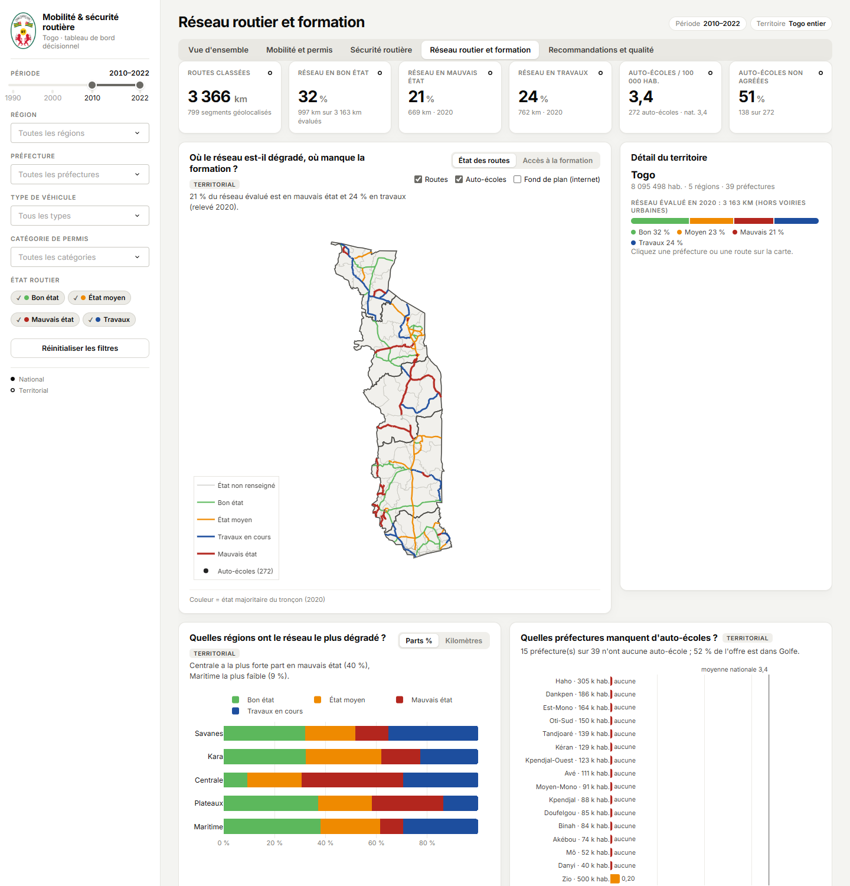

# Mobilité et sécurité routière au Togo — rapport méthodologique

*Tableau de bord décisionnel — note de méthode, octobre 2026. Tous les chiffres sont recalculés par
`python app.py --rebuild` à partir des fichiers fournis.*

## 1. Objectif et périmètre

Donner aux décideurs un outil unique pour suivre la motorisation, la délivrance des permis, l'accidentalité,
l'état du réseau routier et l'accès à la formation des conducteurs, puis prioriser des actions. Le périmètre
est strictement celui des données fournies : aucune donnée, géolocalisation ou conclusion n'est ajoutée.
Une seule source externe est mobilisée — les limites des préfectures OCHA — pour cartographier et calculer
des superficies.

## 2. Sources et couverture

| Fichier | Contenu | Période | Granularité | Lignes |
|---|---|---|---|---|
| observationdata-akkouh | Immatriculations par type (7 types + total) | 1990–2022 | national | 264 |
| observationdata-wklhvw | Immatriculations détaillées, deux-roues par cylindrée | 2013–2019 | national | 70 |
| observationdata-hxdpzbg | 13 séries : accidents, décès, blessés, taux publié, trafic, fret, permis… | 1990–2022 selon série | national | 209 |
| observationdata-wvtolmb | Permis délivrés par catégorie A–F | 2007–2022 | national | 106 |
| observationdata-kwwolwb | Population résidente RGPH-5 (pays, 6 régions, 39 préfectures, 116 communes, cantons) | 2022 | canton | 759 |
| observationdata-tmdtnad | État du réseau par tronçon (km bon, moyen, mauvais, travaux) | 2020 | tronçon (84) | 371 |
| file-routes-routes-classees | Segments de routes classées (géométrie, type, revêtement) | export 12/2024 | segment (799) | 799 |
| file-entreprises-auto-ecoles | Auto-écoles (point, préfecture, agrément) | export 01/2025 | établissement | 272 |
| 2 dictionnaires | Description des champs routes et auto-écoles | — | — | 107 |
| OCHA COD-AB v02 (externe) | Limites et superficies des 40 unités de niveau 2 | 2021 | préfecture | 40 |

Complétude des cellules : 100 % pour les huit fichiers de données, sauf 2 noms de route manquants (99,98 %).
Aucun doublon exact. Les fichiers sont ouverts en lecture seule ; leur empreinte SHA-256 figure dans
l'inventaire (onglet Qualité).

**Constat structurant** : accidents, décès, blessés, immatriculations et permis ne sont disponibles qu'à
l'échelle nationale et annuelle. Les seules données territoriales sont la population, le réseau routier et les
auto-écoles.

## 3. Nettoyage et contrôles qualité

Principe : les valeurs observées ne sont jamais modifiées ; seuls des libellés et le codage des valeurs
manquantes sont corrigés, et chaque opération est journalisée (25 étapes dans `qualite_journal.csv`).

**Contrôles (52 au total : 44 conformes, 1 écart, 7 informations)** — principaux résultats :

| Contrôle | Résultat |
|---|---|
| Total des immatriculations = somme des 7 types | 33 / 33 années |
| Immatriculations 4 roues et deux-roues = séries du fichier national | 33 / 33 et 9 / 9 années |
| Total des permis = somme des catégories = série nationale | 15 / 15 années |
| Population : régions = Togo ; préfectures = région ; communes = préfecture ; cantons = commune | 6/6, 6/6, 39/39, 116/116 |
| État du réseau : bon + moyen + mauvais + travaux = total du tronçon | 84 / 84 tronçons |
| Somme des tronçons = total publié (routes revêtues ; en terre) | 2 198,5 km ; 965,0 km (écart < 0,1 km) |
| Région du code de tronçon = région des géométries appariées | 64 / 64 |
| Correspondance préfectures OCHA ↔ RGPH-5 | 39 / 39 |
| Segments / auto-écoles situés dans leur préfecture déclarée | 97,1 % / 98,5 % (écarts près des limites) |
| **Écart** : type de route cohérent avec le revêtement | 754 / 799 segments (45 incohérences signalées) |

**Corrections et anomalies notables (20 tracées)** :

- **Libellé erroné du taux national** : la série « Accidents mortels /100.000 hab » vaut 92,7 en 2022. Or
  accidents ÷ 92,73 × 100 000 = 8 095 498 habitants, soit exactement la population RGPH-5 2022 ; avec les décès,
  le taux serait 8,4. La série mesure donc **tous les accidents** : elle est renommée, valeurs inchangées.
- **Permis 2013** : publié « 0 » sans aucune ligne par catégorie et absent de la série nationale → valeur
  manquante (affichée « n.d. »), et non zéro.
- **Population** : deux coquilles (« TOTOAL AVE », « BINAH2 ») et deux communes dupliquées (« EST-MONO 1 » et
  « AMOU 2 » en double) renommées EST-MONO 3 et AMOU 3 ; les sommes de contrôle valident ces corrections.
- **Valeurs atypiques** (écart ≥ × 1,8 aux deux années précédentes et suivantes, procédure itérative) et
  **ruptures de niveau** (variation ≥ × 3 persistante), conservées et cerclées sur les graphiques : accidents
  2010 et 2015, permis A 2019 (× 8,9) et 2022 (× 21,6), permis C 2015, permis E 2016 ; ruptures deux-roues
  1995, permis B 2016, permis E 2017.
- **Taux publié 2010 arrondi** (50,0) : dénominateur implicite approximatif, signalé.
- **Routes** : 8 segments à « 0 voie » recodés manquants ; 2 segments sans nom ; 3 segments < 10 m.
- **Nature des immatriculations** : la série fluctue d'une année à l'autre (ex. 7 250 en 1992, 4 349 en 1993),
  ce qui correspond à des flux annuels et non à un parc cumulé ; aucun parc en circulation n'est estimé.

**Harmonisation géographique** : clé normalisée (majuscules, sans accents, tirets → espaces). Le District
autonome du Grand Lomé (Golfe, Agoè-Nyivé) est rattaché à la région Maritime, comme dans les bases routes et
auto-écoles, et reste distinct au niveau préfectoral. Côté OCHA : « Naki-Ouest » = Kpendjal-Ouest, « Plaine du
Mo » = Mô, « Lome Commune » fusionnée avec Golfe. La préfecture de Mô n'apparaît dans aucune base
géolocalisée ; le contrôle spatial confirme qu'aucun segment ni aucune auto-école ne tombe dans son polygone.

**Rattachement des 84 tronçons évalués** à une région (table de correspondance créée car nécessaire, méthode
tracée tronçon par tronçon) : (1) code régional porté par le libellé (TGR + M/P/C/K/S) — 64 tronçons ;
(2) appariement aux géométries par nom normalisé (similarité ≥ 0,92) ou nom proche (≥ 0,60) et longueur
concordante à ± 5 % — 16 tronçons ; (3) toponymes du libellé reconnus dans la nomenclature RGPH-5 — 4 tronçons
(86,5 km, non cartographiables). 80 tronçons (3 077 km, 97,3 %) sont retrouvés dans les géométries, dont la
longueur géodésique est calculée sur l'ellipsoïde WGS84.

## 4. Définitions des indicateurs

| Indicateur | Définition | Statut |
|---|---|---|
| Immatriculations | Véhicules immatriculés dans l'année (flux), types sélectionnés | observé |
| Croissance annuelle / TCAM | (Nₜ/Nₜ₋₁ − 1) ; (N_fin/N_début)^(1/n) − 1 | calculé |
| Part des deux-roues | Deux-roues ÷ immatriculations × 100 | calculé |
| Permis pour 100 véhicules | Permis A ÷ deux-roues × 100 ; permis B ÷ (voitures + utilitaires) × 100 | calculé |
| Accidents pour 100 000 hab. | Valeur publiée (libellé corrigé), vérifiée | observé |
| Décès pour 100 000 hab. | Décès ÷ population implicite × 100 000 ; population implicite = accidents ÷ taux publié × 100 000 | calculé |
| Décès pour 100 accidents | Décès ÷ accidents × 100 (gravité) | calculé |
| Accidents (décès) pour 10 000 immatriculations | ÷ immatriculations de l'année × 10 000 — proxy de tendance, pas un risque par véhicule | calculé |
| Part du réseau en mauvais état / en travaux | km « mauvais » (« travaux ») ÷ km évalués × 100 | région : calculé ; préfecture : **estimé (≈)** |
| Km dégradés pour 100 000 hab. | km en mauvais état ÷ population 2022 × 100 000 | calculé |
| Desserte routière | km de routes classées ÷ superficie OCHA × 1 000 | calculé |
| Auto-écoles pour 100 000 hab. | auto-écoles recensées ÷ population 2022 × 100 000 | calculé |
| Score de priorité | Moyenne pondérée des rangs centiles (0–100, 100 = plus défavorable) : mauvais état 40 %, déficit de formation 35 %, faible desserte 25 % ; élevée ≥ 65, moyenne 45–65, à surveiller < 45 | calculé |

L'estimation préfectorale de l'état répartit les km de chaque tronçon au prorata de ses segments situés dans
la préfecture : elle suppose un état homogène le long du tronçon. Le rang centile évite que les valeurs
extrêmes du Grand Lomé écrasent l'échelle ; une composante absente (Mô : aucun réseau évalué) est exclue et les
poids restants sont renormalisés. Mortalité, accidentologie et motorisation, demandées pour le score, ne
peuvent pas y entrer : elles ne sont pas territorialisées.

## 5. Principales analyses

**Motorisation.** 93 770 immatriculations en 2022, contre 49 378 en 2010 (+90 %, TCAM 5,5 %). Les deux-roues
dominent : 72 % des immatriculations de 2022 (67 639), entre 65 % et 78 % chaque année depuis 2010.

**Permis.** 24 598 permis délivrés en 2022, dont 69 % de catégorie B. Les permis A restent marginaux :
0,5 permis A pour 100 deux-roues immatriculés en médiane sur 2010–2022, contre 70,7 permis B pour 100
voitures et utilitaires. Les pics de 2019 et 2022 (2 425 et 4 837 permis A) sont atypiques et à confirmer.

**Sécurité routière (national).** En 2022 : 7 507 accidents, 9 918 blessés, 683 décès, soit 92,7 accidents et
8,4 décès pour 100 000 habitants et 9,1 décès pour 100 accidents. Les décès dépassent de 17 % la moyenne
2017–2019 (584) mais restent sous le pic de 2014 (802) ; rapportés à la population, les années les plus
meurtrières sont 2014 (12,0), 2011 (11,9) et 2012 (11,9). Depuis 2011, première année de base fiable, les
immatriculations progressent de 69 % quand accidents (−5 %) et décès (−8 %) sont stables. La corrélation
annuelle immatriculations–accidents est faible (r = 0,14 ; 13 années) : la croissance du parc n'explique pas à
elle seule l'accidentalité.

**Réseau routier (relevé 2020).** 3 163 km évalués (hors 139 km de voiries urbaines) : 31,5 % en bon état,
23,3 % moyen, 21,2 % mauvais, 24,1 % en travaux. La **Centrale** est la plus dégradée (40 % en mauvais état ;
21,9 km dégradés pour 100 000 hab.), suivie des **Plateaux** (28 %) ; la Maritime l'est le moins (9 %). Les
tronçons les plus dégradés : RN19 Kara–Kabou (76 km, 91 %), RN14 Sokodé–Tchamba–Kaboli (59 km, 68 %), RN27
Langabou–Yégué (56 km, 84 %), et quatre axes frontaliers des Plateaux (RN30, RN33, RN15B, RN13) en mauvais état sur 98 à 100 % de leur longueur.

**Formation.** 272 auto-écoles, soit 3,4 pour 100 000 habitants, mais 78 % sont dans le Grand Lomé (9,7 pour
100 000 contre 0,8 dans le reste de la Maritime). **15 préfectures sur 39 (1,8 million d'habitants) n'en ont
aucune**, dont Haho (305 096 hab.), Dankpen, Est-Mono et Oti-Sud. 51 % des auto-écoles ne sont pas agréées
(67 % en Centrale, 60 % dans les Savanes).

**Croisement territorial.** Sept préfectures sont en priorité élevée : Mô, Danyi, Blitta, Tchamba, Est-Mono,
Akébou et Anié. Cinq cumulent un réseau plus dégradé que la médiane et une offre de formation inférieure à la
médiane : Danyi, Est-Mono, Anié, Ogou et Zio. Le croisement formation × accidents n'est pas possible : les
accidents ne sont pas ventilés par territoire et le fichier auto-écoles n'a pas de dimension temporelle.

## 6. Limites

1. Pas d'accidentalité territoriale ni infra-annuelle : impossible de désigner des zones, tronçons ou mois
   accidentogènes ; la carte des taux est affichée « indisponible ».
2. Pas de parc en circulation : les taux « pour 10 000 véhicules » reposent sur les immatriculations de l'année.
3. Un seul relevé d'état (2020), par tronçon et sans localisation des sections dégradées ; l'état préfectoral
   est une estimation.
4. Champs du dictionnaire absents des exports (praticabilité, zone inondable, dates de collecte, date de création
   des auto-écoles) : pas d'indicateur « routes praticables », pas d'évolution de l'offre de formation.
5. Population disponible pour 2022 uniquement ; séries annuelles rapportées à la population implicite du taux
   publié.
6. Limites OCHA 2021 et nomenclature RGPH-5 2022 : écarts mineurs aux frontières de préfectures.

## 7. Recommandations

Les 51 recommandations (18 élevées, 24 moyennes, 9 à surveiller) sont générées par des règles explicites
(`src/recommendations.py`) et citent chacune l'indicateur qui les justifie. Les priorités élevées :

| Domaine | Territoire | Constat mesuré | Action |
|---|---|---|---|
| Urgence | Togo | 683 décès en 2022, +17 % / 2017–2019 | Contrôles vitesse, alcool, casque sur les axes nationaux ; objectif chiffré annuel |
| Urgence | Togo | 7 507 accidents, +37 % / 2017–2019 | Chaîne de secours sur les axes à fort trafic |
| Formation | Togo | 72 % de deux-roues, 0,5 permis A pour 100 deux-roues | Campagne de permis moto ; permis A exigé à l'immatriculation |
| Formation | Haho, Dankpen, Est-Mono, Oti-Sud | aucune auto-école pour 150 000 à 305 000 hab. | Antennes agréées, sessions mobiles de formation et d'examen |
| Infrastructures | RN19, RN14, RN27, RN30, RN33, RN15B, RN13 | 20 à 76 km en mauvais état, 68–100 % du tronçon | Entretien prioritaire ; signalisation des sections dégradées |
| Infrastructures | Centrale, Plateaux | 40 % et 28 % du réseau en mauvais état | Programmes régionaux d'entretien |
| Données | Togo | accidents non géolocalisés ; pas de parc roulant | Géocoder chaque accident ; publier le parc par région |

Gouvernance des données, au-delà : relevé annuel de l'état par section géolocalisée avec l'identifiant des
routes classées, export complet des champs documentés, note méthodologique et libellés corrigés à chaque
publication.

## Annexe — fichiers produits

`data/processed/` : tables nettoyées (immatriculations, permis, séries nationales, sécurité routière, population,
auto-écoles, segments, tronçons), indicateurs régionaux et préfectoraux, recommandations, et tables de contrôle
(`qualite_inventaire_fichiers.csv`, `qualite_inventaire_variables.csv`, `qualite_controles.csv`,
`qualite_anomalies.csv`, `qualite_journal.csv`).
