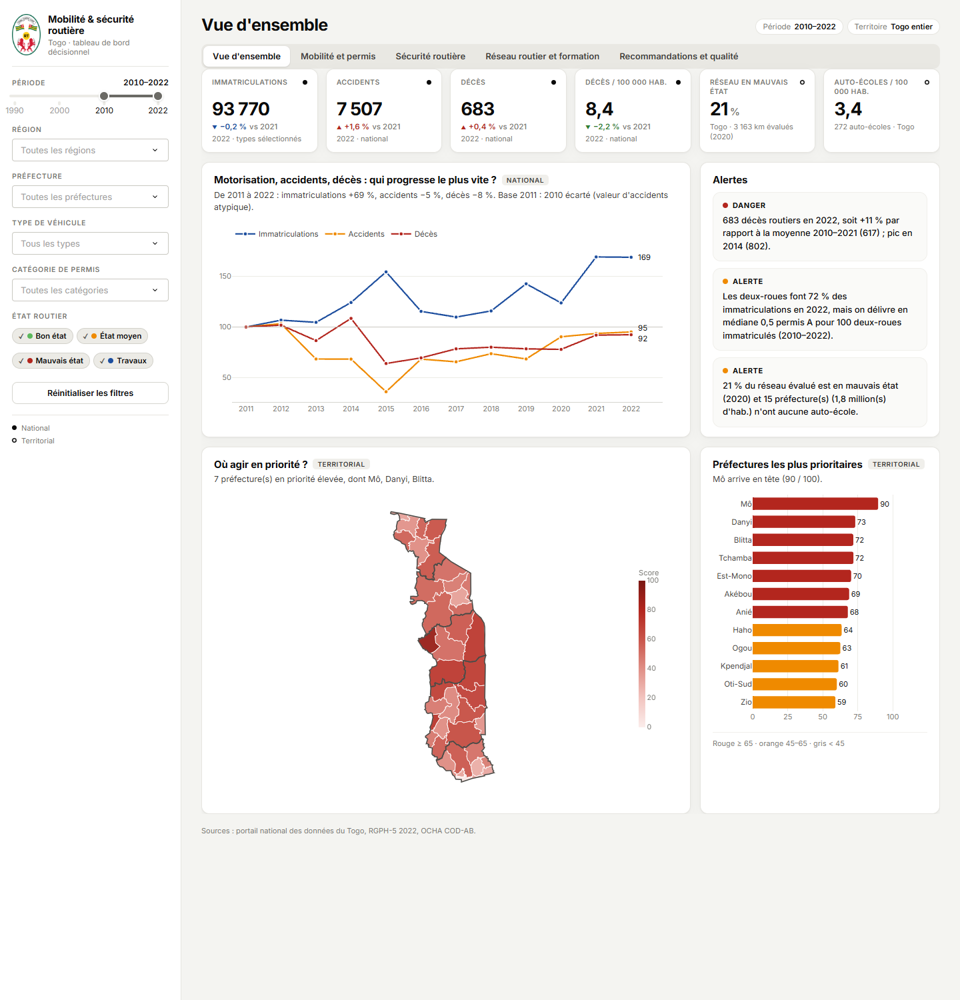

# Mobilité et sécurité routière au Togo

Tableau de bord décisionnel (Dash / Plotly) : immatriculations, permis, accidents, état du réseau routier et
auto-écoles, avec un score de priorité par préfecture et des recommandations.



## Démarrage

Prérequis : **Python 3.10 ou plus** ([python.org](https://www.python.org/downloads/) ; sous Windows, cocher
« Add python.exe to PATH » pendant l'installation) et une connexion internet **à la première utilisation
seulement**.

Décompresser l'archive, puis :

| Système | Fichier | Action |
|---|---|---|
| Windows | `demarrer_windows.bat` | double-clic |
| macOS | `demarrer_macos.command` | double-clic (la première fois : clic droit › Ouvrir, pour passer l'avertissement de sécurité) |
| Linux | `demarrer_linux.sh` | `./demarrer_linux.sh` dans un terminal |

### Ce qui se passe après le double-clic

Une fenêtre de console s'ouvre et affiche les étapes :

```
  [1/3] Première utilisation : création de l'environnement Python local .venv - environ 20 secondes...
  [2/3] Installation des bibliothèques : 2 à 5 minutes la première fois, connexion internet requise...
  [3/3] Démarrage du tableau de bord...

Préparation des données (lecture, nettoyage, indicateurs)...
Données prêtes en 5,2 s.

  Tableau de bord : http://127.0.0.1:8050
  Le navigateur va s'ouvrir automatiquement.
  Laissez cette fenêtre ouverte pendant l'utilisation ; fermez-la ou faites Ctrl+C pour arrêter.
```

1. **Environnement Python local** : un dossier `.venv` est créé dans le projet. Les bibliothèques y sont
   installées sans toucher au Python de l'ordinateur. Étape faite une seule fois.
2. **Bibliothèques** (Dash, Plotly, pandas, GeoPandas…) : téléchargées et installées la première fois, avec
   défilement des lignes d'installation pip. Aux lancements suivants, l'étape affiche « Bibliothèques déjà
   installées » et ne prend aucun temps (elle ne se relance que si `requirements.txt` change).
3. **Préparation des données** : à chaque lancement, les CSV de `data/raw/` sont relus, nettoyés et les
   indicateurs recalculés (5 à 10 secondes). Les fichiers sources ne sont jamais modifiés.
4. **Ouverture** : le navigateur par défaut s'ouvre sur <http://127.0.0.1:8050> dès que le serveur est prêt.
   L'interface s'affiche en 2 à 3 secondes ; les cartes peuvent mettre un peu plus longtemps.

| Lancement | Attente avant l'interface |
|---|---|
| Premier | 2 à 5 minutes selon la connexion (surtout le téléchargement des bibliothèques) |
| Suivants | une dizaine de secondes |

La fenêtre de console est le serveur : elle doit rester ouverte. Fermer l'onglet du navigateur ne l'arrête pas ;
fermer la console (ou Ctrl+C) arrête le tableau de bord. Un nouveau double-clic alors qu'il tourne déjà rouvre
simplement l'onglet.

### En cas de problème

| Message ou symptôme | Solution |
|---|---|
| « Python 3.10 ou plus est introuvable » | Installer Python depuis python.org (cocher « Add python.exe to PATH »), puis relancer. |
| « Le dossier n'est pas décompressé » | Clic droit sur le .zip › Extraire tout, puis lancer le fichier depuis le dossier extrait. |
| « L'installation des bibliothèques a échoué » | Vérifier la connexion internet (ou le proxy) et relancer : l'installation reprend. |
| Erreur « Long Path » ou « Impossible de créer l'environnement » | Chemin trop long pour Windows : déplacer le dossier près de la racine (ex. `C:\securite-routiere-togo`), supprimer `.venv` et relancer. |
| Le navigateur ne s'ouvre pas | Copier l'adresse affichée dans la console (`http://127.0.0.1:8050`) dans un navigateur. |
| « Port 8050 occupé » | Rien à faire : le port suivant libre est utilisé et son adresse est affichée. |
| Option « Fond de plan (internet) » sans effet | Elle nécessite une connexion ; sans elle, les cartes restent lisibles (limites administratives). |
| Repartir de zéro | Supprimer le dossier `.venv` et relancer. |

### Lancement manuel

```bash
pip install -r requirements.txt
python app.py
```

| Option | Effet |
|---|---|
| `--port 8060` | autre port |
| `--no-browser` | ne pas ouvrir le navigateur |
| `--rebuild` | régénérer les tables de `data/processed/` |
| `--host 0.0.0.0` | accès depuis les autres postes du réseau local |

Les options passent aussi par les scripts : `demarrer_windows.bat --port 8060`.

## Utilisation

- **Barre latérale (gauche)** : filtres globaux (période, région, préfecture, type de véhicule, catégorie de
  permis, état routier) appliqués à toutes les vues, et bouton « Réinitialiser les filtres ».
- **En-tête** : titre de la vue et rappel des filtres actifs.
- **Onglets** : les cinq vues ci-dessous.
- **Clic sur une préfecture** (carte ou graphique) : filtre tout le tableau de bord ; clic sur une route :
  détail du tronçon.
- **Exports** : bouton « Exporter CSV » sur les tableaux ; icône appareil photo au survol d'un graphique pour
  l'enregistrer en PNG.
- **Liens directs** : `http://127.0.0.1:8050/?vue=reseau&region=Kara` ouvre une vue déjà filtrée
  (`vue` = `overview`, `mobilite`, `securite`, `reseau`, `reco`).

| Vue | Contenu |
|---|---|
| Vue d'ensemble | KPI, évolution comparée, alertes, carte des priorités |
| Mobilité et permis | Immatriculations par catégorie, permis par catégorie |
| Sécurité routière | Accidents, blessés, décès, taux, années critiques |
| Réseau routier et formation | Carte des tronçons, état par région, auto-écoles, comparaison de régions |
| Recommandations et qualité | Recommandations priorisées, contrôles qualité, méthodologie |

## Données

- `data/raw/` : fichiers CSV sources (non modifiés).
- `data/reference/tgo_admin2.geojson` : limites des préfectures, OCHA COD-AB Togo via HDX (CC BY-IGO).
- `data/processed/` : tables nettoyées, indicateurs et tables de contrôle qualité.

Accidents, immatriculations et permis ne sont disponibles qu'au niveau national : les comparaisons
territoriales portent sur le réseau routier, la population et les auto-écoles.

## Structure

```
app.py                    point d'entrée
demarrer_windows.bat      démarrage Windows
demarrer_macos.command    démarrage macOS
demarrer_linux.sh         démarrage Linux
src/                      chargement, nettoyage, géographie, indicateurs, graphiques, interface
assets/                   style et armoiries
data/                     sources, référentiel géographique, tables traitées
tests/                    tests
```

Tests : `python tests/test_dashboard.py`

Méthodologie détaillée : [RAPPORT_METHODOLOGIQUE.md](RAPPORT_METHODOLOGIQUE.md)
